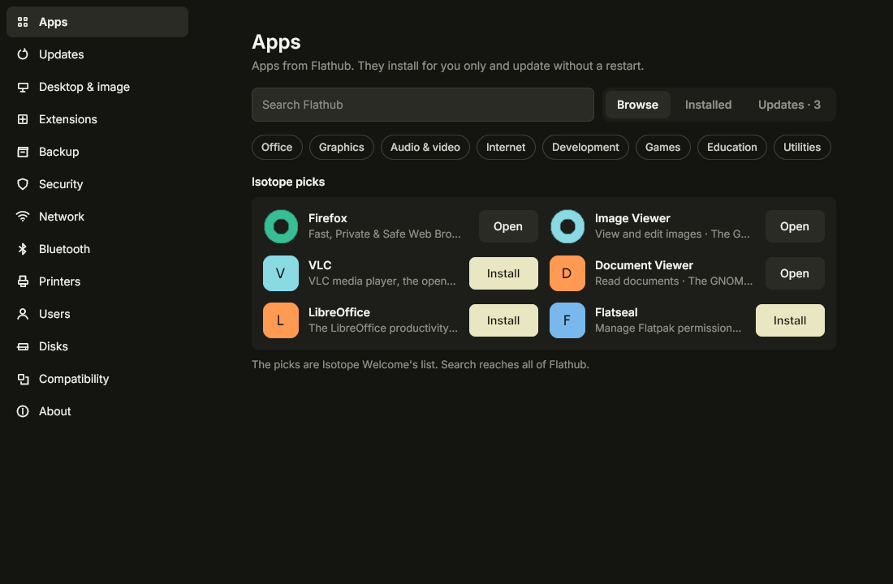

# Apps

You install apps from Flathub. The system of Isotope is a read-only image, so apps do not go into it. Each app installs for your user only. You do not need a password, and an app update does not need a restart.

Open the page: press [[Super+Escape]] and choose **Install apps**. The **Apps** page of Isotope System opens. It has three tabs: **Browse**, **Installed** and **Updates**.

On COSMIC, you can also use the COSMIC Store.

## Find an app

Open the **Browse** tab. Then do one of these:

- Type a name or a word in **Search Flathub**.
- Choose a category, for example **Office** or **Games**.
- Look at **Isotope picks**, the apps that Isotope Welcome offers.

Click an app to see its details.

The details show the developer, the version, the download size and the licence. **Verified** means that Flathub verified the developer. **What it can reach** lists what the app can use outside of its sandbox: your files, the network, the sound, devices. Access to your home folder or to all files shows in amber.

## Install an app

1. Open the details of the app.
2. Click **Install**.

The progress shows on the page. You can close the window: the installation continues.

## Open or remove an app

1. Open the **Installed** tab.
2. Click **Open** to start the app, or **Remove…** to remove it.
3. To remove the files that the app saved too, select **Also delete its data**. This choice is off by default.

## Update your apps

Isotope updates your apps automatically each day. The update does not run on a metered connection, or on battery below 30%.

To update now:

1. Open the **Updates** tab.
2. Click **Update all**.

Some updates show under **Needs your OK**. The new version of such an app asks for more than the version you have, for example access to your files or to the network. Automatic updates do not install it. Click **Review…** to see what it asks for. Then click **Update**, or click **Cancel** to keep the version you have.

A running app gets its update when you close it and open it again.

To stop automatic app updates, click **Turn off** next to **Update apps automatically**. You can also use the command `isotope apps auto off`.

## When Flathub is not set up

If the page says **Flathub is not set up for this user**, you cannot install or update apps from this page. The apps that you have still open, and you can remove them. If this does not change after a restart, [report the problem](help.md#report-a-problem).

## Programs that are not on Flathub

- To add a program to the system itself, such as a driver or a service, use [Extensions](extensions.md).
- To run a program that you downloaded for another Linux system, see [Compatibility](compatibility.md).
