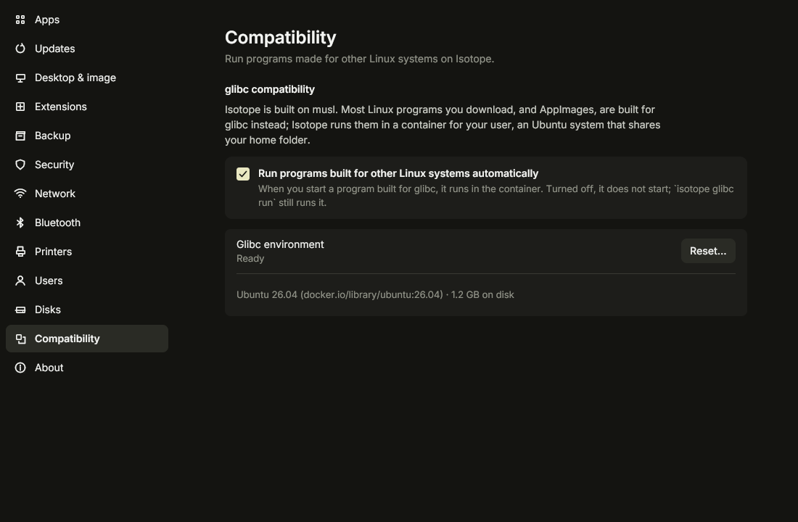

# Compatibility

Isotope is built on musl. Most Linux programs that you download, and AppImages, are built for glibc instead. Isotope runs these programs in a container for your user: an Ubuntu system that shares your home folder. Its name is the glibc environment.

You start such a program the usual way, for example `./program` in a terminal. An AppImage starts the same way once it is executable (`chmod +x`). When the program needs glibc, Isotope sends it to the glibc environment by itself.

Open the page: press [[Super+Escape]], choose **System**, then choose **Compatibility**.

## Turn it on or off

Use the switch **Run programs built for other Linux systems automatically**. It is on by default.

When it is off, a program built for glibc does not start. You can still start it with `isotope glibc run`.

## Set up the glibc environment

Isotope sets up the glibc environment the first time that you start such a program. The first start downloads an Ubuntu image, so it takes a few minutes.

To set it up before then, click **Set up now**. You can close the window: the setup continues, and a notification tells you when it is done.

The page shows the state:

- **Not set up yet**: there is no glibc environment.
- **Ready**: the environment works. The page shows its Ubuntu image and the disk space that it uses.
- **Being set up**: another window, or the first start of a program, sets it up now.

If the page shows **Download now**, the Ubuntu image was removed. Click it to download the image again.

## Start again from new

If the glibc environment does not work, click **Reset…**, then confirm. Isotope removes the container and makes it again. Your home folder does not change.

## Other ways

- For desktop apps, use [Apps](apps.md) from Flathub first. They work on Isotope without the glibc environment.
- `isotope glibc enter` opens a shell in the glibc environment.
- Distrobox is included. You can make your own containers with other Linux systems.

For more, read [Run programs built for glibc](../../docs/glibc-programs.md).
