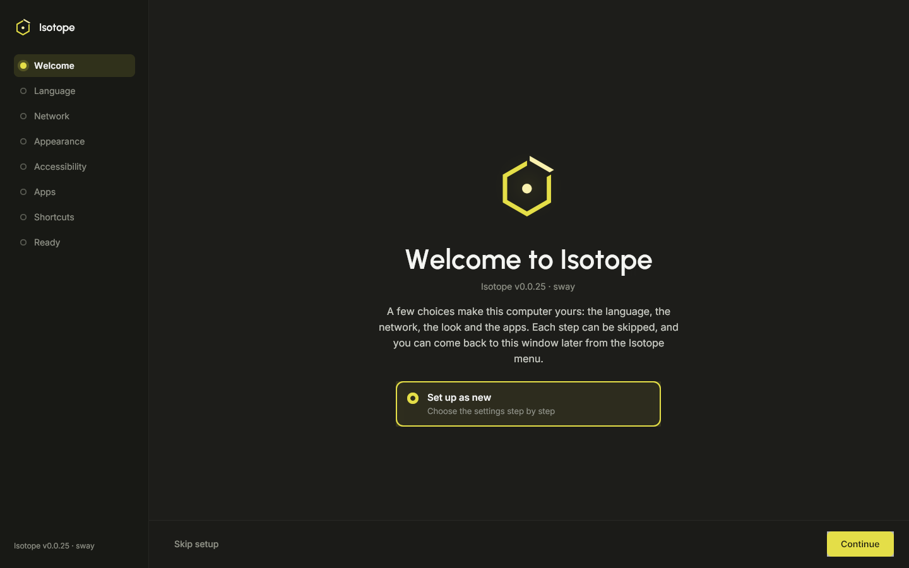
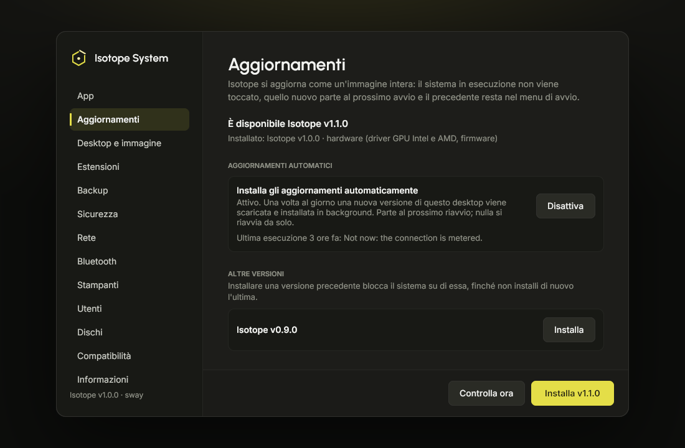

# First login and Isotope Welcome

After the installation, the computer starts Isotope. If you encrypted the disk, type the disk passphrase first. Then log in with the user name and password that you chose in the installer.

## Isotope Welcome

At your first login, the **Isotope Welcome** window opens. It helps you set up the computer in a few steps. You can skip each step.

On the first page, choose one of these:

- **Set up as new**: go through the steps below.
- **Restore from a backup**: bring back a computer from its Isotope backup. See [Restore on a new computer](backup.md#restore-on-a-new-computer). Only an administrator sees this choice, and only on a new computer.
- **Skip setup**: close the window. You can open it again later.

Click **Continue** to go to the next step. Click **Skip** to leave a step as it is. Click **Go back** to go to the previous step.

## The steps

| Step | What you do |
|---|---|
| **Language** | Choose the language of the system. It applies to every user of the computer. Only an administrator can change it. |
| **Network** | Choose a Wi-Fi network and type its password. With a network cable, you are already online. You can continue without a network. |
| **Appearance** | Choose the dark look (the default) or a light one. |
| **Layout**, **Workflow**, **Launcher** | On COSMIC only. **Layout** places the panel and the dock. **Workflow** and **Launcher** show how COSMIC works; they change nothing. |
| **Accessibility** | Make the screen easier to read: a larger display scale, or larger text. |
| **Apps** | Choose a browser and other apps to install from Flathub. This step needs a network. |
| **Shortcuts** | The most important keys. Click **Show all shortcuts** for the full list. |
| **Ready** | What Isotope set up. If you changed the language, click **Log out** to use it. |

If you skip the **Apps** step because there is no network, Isotope reminds you at your next login.

## Languages

Isotope System, Isotope Welcome, the installer and the update icon are translated into Italian and Spanish. They use the language of the system, which you choose in the **Language** step. The new language starts at your next login. In every other language they show English.

To translate Isotope into your language:

1. Add the language code, for example `fr`, to [`pkg/i18n/po/LINGUAS`](../../pkg/i18n/po/LINGUAS).
2. In the repository, run `go run ./tools/i18n update`. This makes the file `fr.po` in each folder under `pkg/i18n/po/`.
3. Translate each `msgstr` in those files. Keep `%s`, `%d` and the other `%` codes as they are.
4. Run `go run ./tools/i18n check`. It shows each text that is still missing.
5. Open a pull request.

When you change a text in the code, run `go run ./tools/i18n update` again and translate the new texts.

## Open Isotope Welcome again

Isotope Welcome opens only at the first login of each user. To open it again:

1. Press [[Super+Escape]] to open the Isotope menu.
2. Choose **Welcome**.

You can also open one step from a terminal, for example `isotope welcome apps`. The steps are `apps`, `language`, `network`, `appearance`, `accessibility` and `shortcuts`.

## Next steps

- Learn the keys of your desktop: [Desktops, the Isotope menu and keys](desktops.md).
- Install more apps: [Apps](apps.md).
- Set up backups: [Backup and restore](backup.md).
