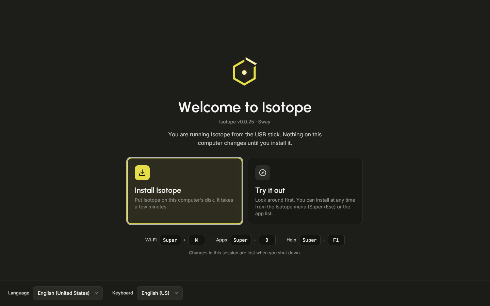
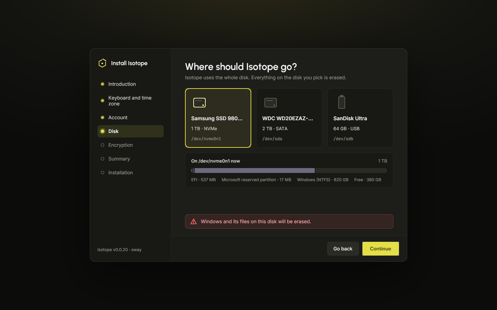
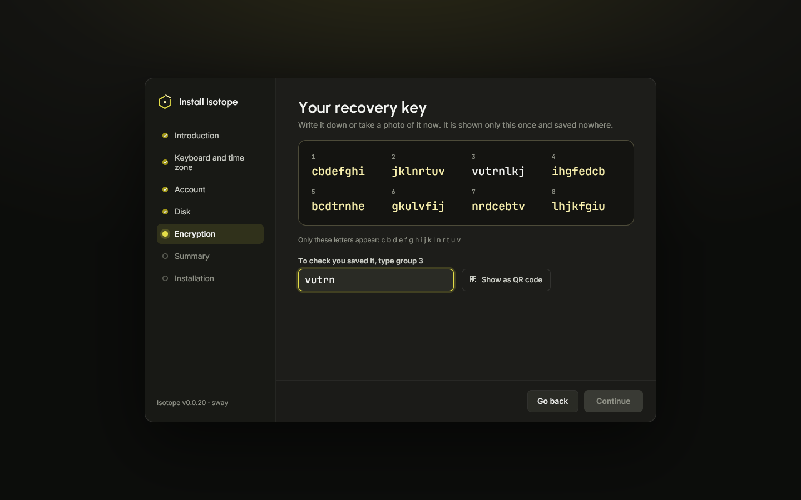

# Install Isotope

Isotope installs from a USB stick. The desktop ISOs start a live desktop first, so you can try Isotope before you change your disk.

## What you need

- A 64-bit PC (amd64) with UEFI firmware.
- 4 GB of RAM. For COSMIC on the Trusted Boot edition, 8 GB.
- A disk of 20 GB or more. The installer erases the whole disk that you choose.
- A USB stick that is larger than the ISO.

## Download the ISO

Go to the [download section of the Isotope website](../index.html#download). Each desktop has two ISOs:

| ISO | Use it on |
|---|---|
| `isotope-<desktop>-<version>-amd64.iso` | Laptops and desktop PCs. It has the graphics drivers and the Wi-Fi, Bluetooth and audio firmware. |
| `isotope-<desktop>-vm-<version>-amd64.iso` | Virtual machines. It is smaller and has no hardware drivers. |

If you do not know which desktop to choose, choose COSMIC. You can change to another desktop later. See [Desktop and image](desktop-and-image.md).

## Write the ISO to a USB stick

1. Download the ISO and its `.sha256` file into the same folder.
2. Make sure that the download is complete: `sha256sum --check isotope-*.iso.sha256`. The command must print `OK`.
3. Write the ISO to the USB stick with a tool such as Fedora Media Writer. On Linux, you can also use `dd`.

> Writing the ISO erases everything on the USB stick.

## Start the computer from the USB stick

1. Put the USB stick in the computer.
2. Start the computer and open its boot menu. The key is often F12, F11 or Esc. Your computer's manual tells you which key to use.
3. Choose the USB stick.

The Isotope boot menu opens:

| Entry | What it does |
|---|---|
| **Isotope** | Starts the live desktop. This is the default. |
| **Isotope (safe graphics)** | Starts the live desktop with the graphics driver off. Use it when the screen stays black. |
| **Install Isotope** | Starts the graphical installer, without the live desktop. |
| **Install Isotope (safe graphics)** | The same, with the graphics driver off. |
| **Install Isotope (text)** | Starts the installer in text mode. |

In a virtual machine, use UEFI firmware, 4 GB of RAM and a disk of 20 GB or more. Choose a virtio GPU if your hypervisor has one.

## Try the live desktop

The live desktop runs from the USB stick. It does not write to your disks. You are logged in as the user `live`, who has no password.

A welcome window opens. Choose your language and your keyboard at the bottom of the window. Then choose one of these:

- **Install Isotope**: opens the installer in a window.
- **Try it out**: closes the welcome window. Make sure that the Wi-Fi, the screen and the sound work.

To start the installer later, open the Isotope menu with [[Super+Escape]] and choose **Install Isotope**.

The live desktop does not lock the screen, does not install updates and does not make backups.

## Run the installer

The installer has these steps. Click **Continue** to go to the next step. Nothing is written to the disk before the last step.

1. **Introduction.** The installer tells you what Isotope is.
2. **Keyboard and time zone.** Choose your keyboard layout and your time zone. If you chose a keyboard on the live desktop, the installer asks only for the time zone.
3. **Account.** Type a computer name, your user name and your password. This account is the administrator of the computer. Optional: type your GitHub user name to let your SSH keys from GitHub log in.
4. **Disk.** Choose the disk for Isotope. The installer shows what is on each disk now.
5. **Encryption.** Choose if Isotope encrypts your files. See [Encrypt the disk](#encrypt-the-disk).
6. **Summary.** Read your choices. Click **Change** to go back to a step. When the choices are correct, click **Erase and install**.
7. **Installation.** The installer writes Isotope to the disk. Do not turn off the computer.

Click **Go back** to go to the previous step.

> Isotope uses the whole disk. The installer erases everything on the disk that you choose. Back up your files before you start.

When the installer shows **Isotope is installed**, remove the USB stick and click **Restart now**.

If the graphics do not start, the installer starts in text mode. The text installer asks the same questions.

If the installation fails, the installer shows the end of its log. Click **Save the log** to keep it, and attach it when you [report the problem](help.md#report-a-problem).

## Encrypt the disk

Encryption is off unless you choose it. With encryption, nobody can read your files from a lost or stolen disk.

1. In the **Encryption** step, choose **Encrypt my files**.
2. Type a disk passphrase two times. It must have 12 characters or more. A few words work well.
3. Optional: select **Also create a recovery key**. A recovery key opens the disk if you forget the passphrase.

You type the disk passphrase each time the computer starts. The prompt is **Enter the disk passphrase**, or **Enter the disk passphrase or recovery key** if the disk has a recovery key.

> If you forget the passphrase and have no recovery key, nobody can read your files. Isotope keeps no copy of the passphrase.

### Save the recovery key

The installer shows the recovery key one time only. It saves the key nowhere.

1. Write the key down, or take a photo of it. Click **Show as QR code** to scan it with a phone.
2. Type the group of letters that the installer asks for. This shows that you saved the key correctly.
3. Keep the key away from the computer.

You can make a new recovery key after the installation. See [Security and the recovery key](security.md).

## The Trusted Boot edition

The Trusted Boot edition is for PCs with UEFI Secure Boot and a TPM 2.0 chip. The computer starts only Isotope images that the project signed. The TPM chip keeps the key of the disk, so the disk cannot be read in another computer. If a release has Trusted Boot ISOs, the download section of the website lists them.

1. In the firmware setup of the computer, put Secure Boot in setup mode. Most laptops need you to clear the Secure Boot keys first.
2. Start the Trusted Boot ISO. On the first start, it enrolls the project's keys and restarts.
3. Run the installer. It does not ask for a disk passphrase: the TPM unlocks the disk.
4. Optional: in the **Encryption** step, choose **Create a recovery key**.

Keep Secure Boot on after the installation. Updates stay in the Trusted Boot edition. To leave it, install Isotope again from a normal ISO.

> Make a recovery key. If the TPM is reset, or a firmware update changes what the TPM checks, the disk opens only with the recovery key. After such a start, open the **Security** page and click **Seal again**. See [Security and the recovery key](security.md).
