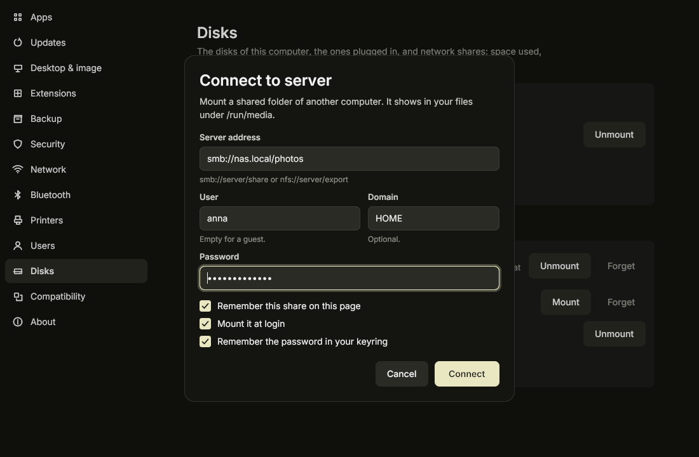

# Network shares

A network share is a folder on another computer, such as a NAS or a Windows PC. Isotope mounts SMB shares (Windows, Samba, most NAS) and NFS shares (version 4.1 or later).

You find network shares in the **Network shares** section of the **Disks** page. Open it: press [[Super+Escape]], choose **System**, then choose **Disks**.

## Connect to a share

1. Click **Connect to server…**.
2. Type the **Server address**. For SMB, type `smb://server/share`, for example `smb://nas.local/photos`. For NFS, type `nfs://server/export`.
3. For SMB, type the **User** and the **Password**. Leave **User** empty for a guest. Type the **Domain** only if the server needs one.
4. Choose what Isotope remembers. See the table below.
5. Click **Connect**.

| Choice | What it does |
|---|---|
| **Remember this share on this page** | Keeps the share in the list. |
| **Mount it at login** | Mounts the share each time you log in. |
| **Remember the password in your keyring** | Saves the password in your login keyring. Without it, Isotope asks for the password each time. |

Isotope mounts the share at `/run/media/<your user name>/<the name of the share>`. Open this folder in your file manager.

## Unmount and forget a share

- Click **Unmount** to disconnect the share. It stays in the list.
- Click **Mount** to connect it again.
- Click **Forget**, then confirm, to remove the share and its saved password from the list.

Isotope unmounts your shares when you log out.

## Mount shares at login

A share with **Mount it at login** mounts when you log in. If the network is not ready, Isotope tries again a few times. If the password is wrong, Isotope stops at once, so that the server does not lock your account. A notification tells you when a share did not mount.

## Who can mount a share

- Every user who sits at the computer can mount an SMB share.
- Only an administrator can mount an NFS share. NFS lets in the computer by its address, not the user, so another user could see files that are not theirs.

On NFS, the files show the owners that the server has. These can be different from your user.

## The firewall

The firewall of Isotope does not block network shares. You do not need to allow a port.
