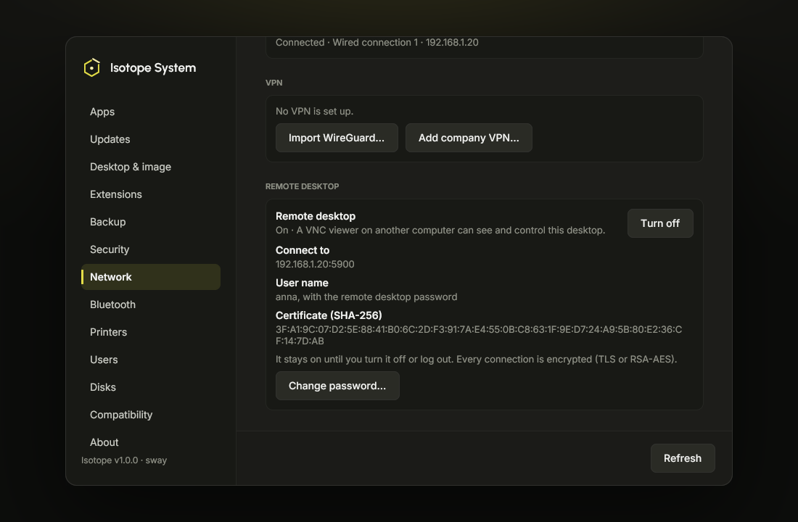
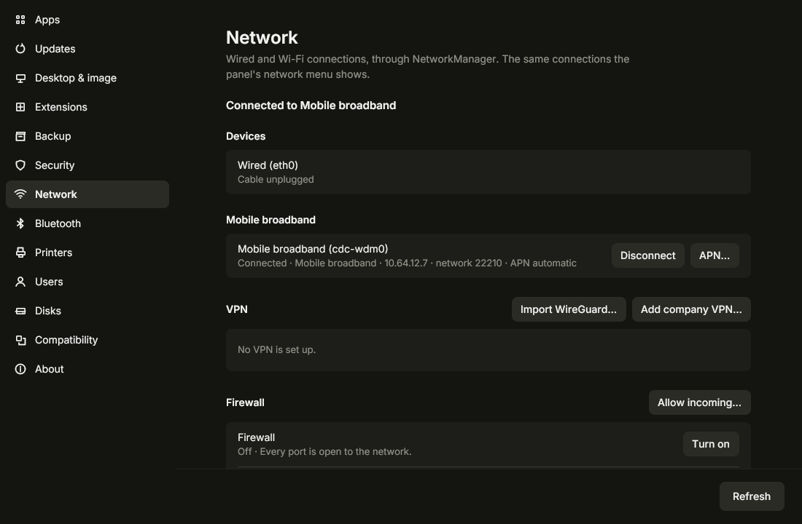

# Network

The **Network** page of Isotope System manages wired and Wi-Fi connections, VPNs, remote desktop, the firewall and mobile broadband. It uses NetworkManager: the network menu of your desktop shows the same connections.

Open the page: press [[Super+Escape]], choose **System**, then choose **Network**.

Every user can connect to networks and VPNs. Only an administrator can change the firewall.

## Wi-Fi

To connect to a Wi-Fi network:

1. Make sure that Wi-Fi is on. If it is off, click **Turn on** next to **Wi-Fi**.
2. Under **NETWORKS IN RANGE**, find the network. Click **Refresh** if it is not there.
3. Click **Connect**.
4. Type the password of the network. A Wi-Fi password has at least 8 characters.

The computer then joins this network by itself when it is in range.

To stop that, find the network under **SAVED NETWORKS** and click **Forget**. Isotope deletes its password.

You can also connect from the Isotope menu: press [[Super+Escape]] and choose **Wi-Fi**. On Sway and i3, [[Super+N]] opens the Wi-Fi menu.

## VPN

The **VPN** section lists your VPN connections. Click **Connect** or **Disconnect** to use one. Click **Remove** to delete a connection and its keys from the computer.

### Add a WireGuard VPN

You need a WireGuard file (`.conf`) from the administrator of the VPN.

1. Click **Import WireGuard…**.
2. Choose the `.conf` file.
3. Optional: type a name for the connection. The file name is the default.
4. Click **Import**.

Isotope does not accept a file that runs commands (`PreUp`, `PostUp`, `PreDown`, `PostDown`), or that sets `SaveConfig` or a numbered `Table`. Ask for a file without these lines.

When a tunnel sends all traffic through the VPN, the names of websites are also looked up through the VPN.

### Add a company VPN

Isotope connects to Cisco AnyConnect, Palo Alto GlobalProtect, Fortinet, Juniper and Pulse (Ivanti) VPNs.

1. Click **Add company VPN…**.
2. Choose the **Type** of the VPN.
3. Type the **Server**: the address that your company gave you, for example `vpn.example.com`.
4. Type your **User name**.
5. Click **Add**.

When you connect, a window asks for your password. If the VPN uses a second factor, such as a code from an app, the window asks for it too.

> A company VPN that logs in through a web page (single sign-on, SAML) does not work.

## Remote desktop

With remote desktop, a person at another computer can see and control your desktop with a VNC viewer, for example TigerVNC, Remmina or RealVNC Viewer. It works on Sway and niri. It does not work on i3 or COSMIC yet, or on the live desktop.

Remote desktop is off until you turn it on. It stays on until you turn it off or log out. While it is on, the firewall allows port 5900 (TCP). Every connection is encrypted.

First, install the `remote-desktop` extension. Only an administrator can do this. Open the **Extensions** page of Isotope System, or click **Open Extensions** in the **REMOTE DESKTOP** section. See [Extensions](extensions.md).

To turn it on:

1. In the **REMOTE DESKTOP** section, click **Turn on**.
2. The first time, type a remote desktop password twice. Use a new password, not your login password. It has 8 to 64 characters.
3. Click **Save and turn on**.

When the firewall is on, only an administrator can turn on remote desktop.

The section then shows what the other person needs:

- **Connect to**: the address and port to type in the viewer, for example `192.168.1.20:5900`.
- **User name**: your user name. The viewer also asks for the remote desktop password.
- **Certificate (SHA-256)**: the first time the viewer connects, it shows a fingerprint. Make sure that it is the same.

Click **Turn off** to stop it. The firewall then blocks port 5900 again. Click **Change password…** to set a new password.

In a terminal, use `isotope remote-desktop password`, `isotope remote-desktop on`, `isotope remote-desktop off` and `isotope remote-desktop status`.

## Firewall

The firewall is on after the installation. It blocks connections that other computers start to this computer, except the ports that you allow. Connections that this computer starts are not blocked.

By default, the firewall allows SSH (port 22, TCP). You can remove it.

### Allow a port

Do this when a program on this computer must accept connections from the network, for example a web server or a game server.

1. In the **FIREWALL** section, click **Allow incoming…**.
2. Type the **Port**, a number from 1 to 65535. For example, 8080 for a web server.
3. Choose the **Protocol**: TCP or UDP.
4. Optional: type a **Description**, for example the name of the program.
5. Click **Allow**.

To block the port again, click **Remove** next to it.

### Turn the firewall off

Click **Turn off**, then confirm. Every port is then open to the network. Click **Turn on** to turn it on again.

The firewall is off on the live desktop. It is on after the installation.

### Use the terminal

| Command | What it does |
|---|---|
| `isotope firewall` | Show the state and the allowed ports. |
| `isotope firewall allow 8080/tcp` | Allow a port. |
| `isotope firewall deny 8080/tcp` | Block a port again. |
| `isotope firewall off` | Turn the firewall off. |
| `isotope firewall on` | Turn the firewall on. |

If the page says **The firewall settings could not be read**, click **Reset to defaults**. The firewall then turns on with the ports that Isotope could still read, or with SSH only.

## Mobile broadband

To use a 4G or 5G modem, first install the `modemmanager` extension. Only an administrator can do this.

1. Open the **Extensions** page of Isotope System.
2. Find **modemmanager** and click **Install**. See [Extensions](extensions.md).

In a terminal, use `isotope ext install modemmanager`.

When the computer has a modem, the **Network** page shows the **MOBILE BROADBAND** section:

1. Click **Connect**.
2. If the modem does not connect, click **APN…** and type the access point name (APN) of your mobile operator. Leave it empty to look it up for the network of the modem.

The section shows the state of the modem, its network and its address. A modem that connects only through PPP does not work.

