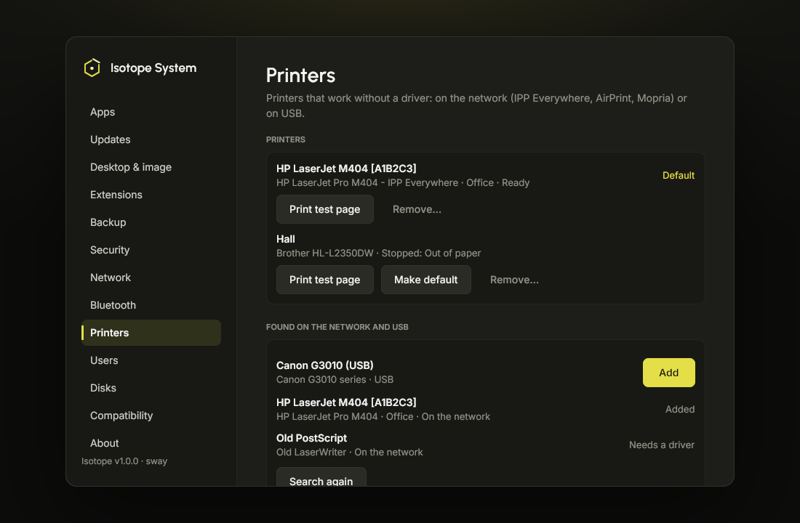

# Printers

Isotope prints to printers that work without a driver: network printers with IPP Everywhere, AirPrint or Mopria, and USB printers with IPP over USB. You do not install a driver.

Open the page: press [[Super+Escape]], choose **System**, then choose **Printers**.

Only an administrator can add or remove printers, or choose the default printer. Every user can print.

## Add a printer

1. Turn the printer on. Connect it to the same network as the computer, or plug it in with USB.
2. Click **Search for printers**.
3. Under **Found on the network and USB**, find the printer and click **Add**.

A USB printer is set up automatically while it is plugged in. It shows **Set up automatically while it is plugged in**.

A printer that shows **Needs a driver** does not work without a driver. Isotope cannot use it.

## Print a test page

Click **Print test page** next to the printer.

## Choose the default printer

Click **Make default** next to the printer. Apps choose the default printer first.

## Remove a printer

Click **⋯** next to the printer, then **Remove…**, then confirm. The printer is removed for every user of the computer, with the print jobs that wait for it. You can add it again later.

## Print from an app

Print from the app as usual, for example with [[Ctrl+P]]. The printers that you added show in the print window of the app.
