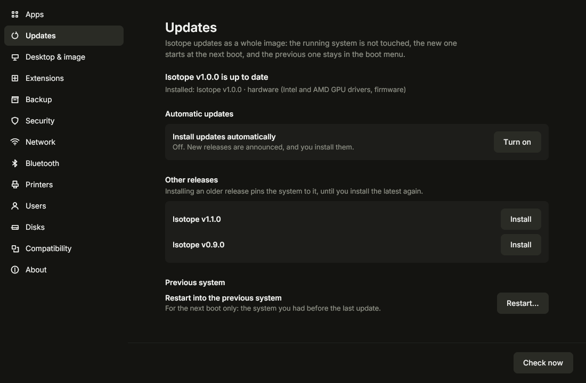

# Updates

Isotope updates as a whole image. The computer keeps two systems on its disk. An update goes to the system that is not running, so nothing you use changes during the update. The new system starts at the next restart. The previous system stays in the boot menu.

Only an administrator can install updates. Every user can look for them.

Open the page: press [[Super+Escape]] and choose **Update**.

## Install a new release

When a new release is ready, the update icon in the panel tells you.

1. Open the **Updates** page.
2. Click **Check now** to look for a new release.
3. If the page says **Isotope vX is available**, click **Install vX**.
4. Wait for the installation to finish. You can use the computer in this time.
5. Click **Restart now**, or restart later.

The new version starts at the next restart. Until then, the page says **Version vX is installed and starts at the next restart**.

In a terminal, `isotope` shows the installed and the latest release. `isotope upgrade` installs the latest release.

If the new system does not start, the computer starts the previous system again. To go back to the previous system yourself, see [Go back to the previous version](rollback.md).

## Install automatic updates

Automatic updates are off by default. When they are on, Isotope looks for a new release each day and installs it in the background. Isotope does not restart the computer: the new version starts at your next restart. After an automatic update, a notification has a **Restart** button.

To turn automatic updates on:

1. Open the **Updates** page.
2. Next to **Install updates automatically**, click **Turn on**.

In a terminal, use `isotope update auto on`. `isotope update auto status` shows the last run.

An automatic update does not run in these cases:

- The connection is metered, for example a phone hotspot.
- The computer is on battery, and the battery is below 30%.
- You went back to the previous version. Isotope does not install that version again. It installs the next newer release.
- You installed an older release yourself (see below).

## Install another release

Under **Other releases**, the page lists the other releases for your desktop. Click **Install** to install one.

> When you install an older release, Isotope stays on it. It does not offer newer releases until you install the latest release again.

## The history

Under **History**, the page lists the updates and the restarts into the previous system.

## Firmware updates

Isotope also updates the firmware of the computer and of its devices: for example the disks, USB devices, Thunderbolt docks and the system firmware. The firmware comes from the Linux Vendor Firmware Service (LVFS).

The **Firmware** section of the **Updates** page lists the devices that can get firmware updates. When an update is ready, the device shows **Version X is available**.

1. Click **Update** next to the device.
2. Read the message, then confirm.
3. Wait until the update is written. Do not turn off the computer or remove the device.
4. If the page asks **Restart to finish the firmware update?**, click **Restart**.

> Some firmware is written while the computer starts. The computer can restart more than once and show its own update screen. Do not turn off the computer.

Isotope cannot restart while a firmware update is written. It tells you to try again when the update is done.

When a firmware update is ready, a notification tells you. Click **Open Isotope System** to see it.

Some firmware updates turn Secure Boot back on. If the computer then does not start Isotope, turn Secure Boot off in the firmware setup.

On the Trusted Boot edition, Isotope does not update the system firmware (UEFI). It updates the other devices.

## App updates

Your apps from Flathub update separately. When app updates are ready, the **Updates** page shows a line, for example **3 app updates**. Click it to open the [Apps](apps.md#update-your-apps) page.
